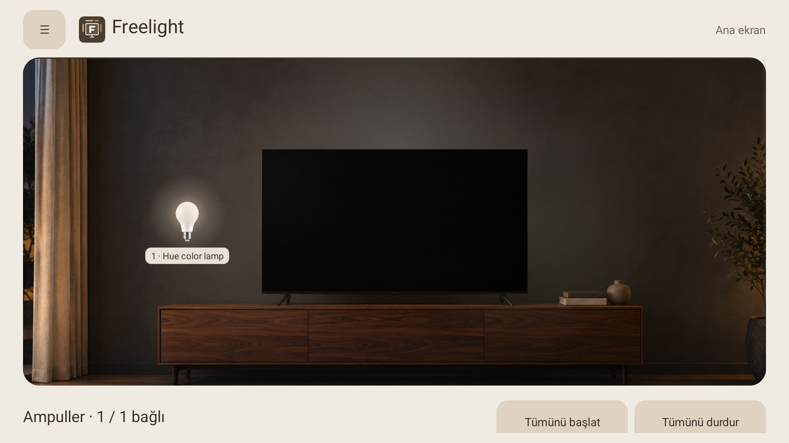
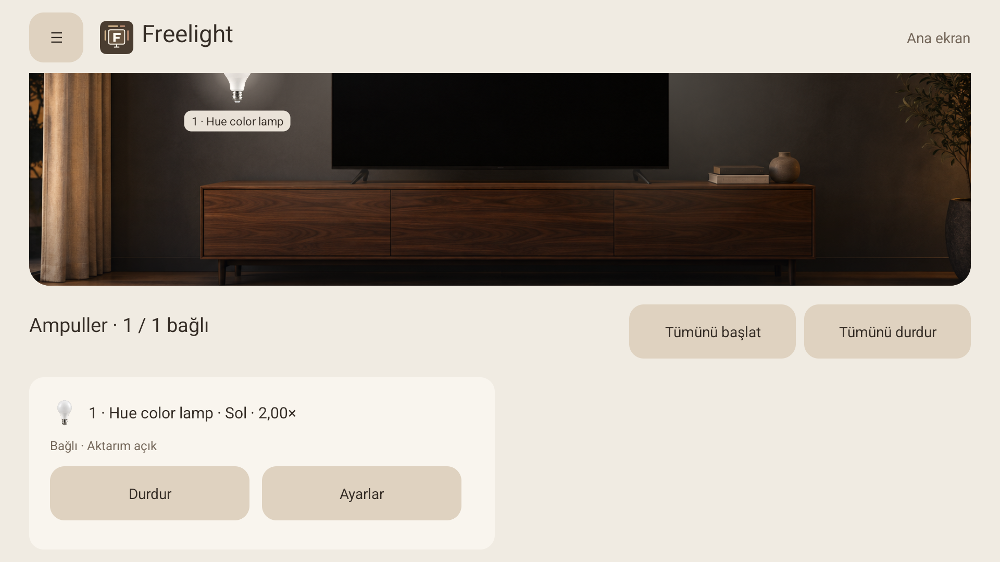
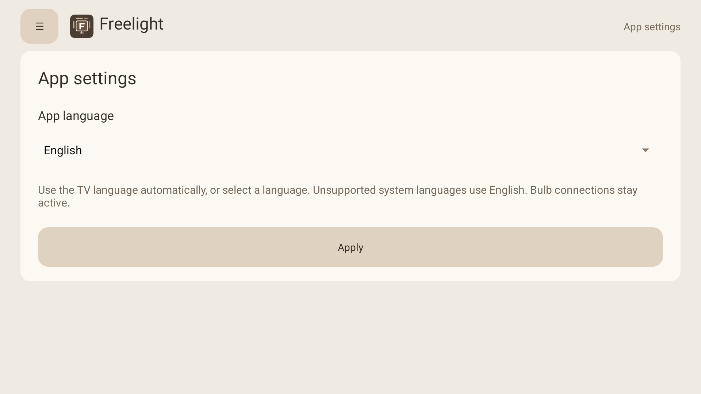

<p align="center">
  
</p>

<h1 align="center">Freelight</h1>
<p align="center">Bring your TV’s Ambilight colors to a Bluetooth Hue bulb.</p>

Freelight is an open-source, experimental Android TV application that reads a Philips TV’s local Ambilight color data and sends matching colors to compatible Philips Hue bulbs over Bluetooth. It runs on the TV itself: after setup, no Mac, PC, Hue Bridge, or cloud service is required for color synchronization.

**Current version: 0.12 · Tested TV: Philips 65OLED810/12 · Tested bulb: Hue LCA012 (RGB).** This is a hardware-specific project, not a universal replacement for Ambilight + Hue. Other TVs, firmware versions, and Hue models need testing.



Screenshots show the previously tested 0.11 interface; new 0.12 onboarding screenshots will be added after physical-TV validation.

## What it does

- Reads the TV’s existing Ambilight RGB zones rather than capturing the screen or video.
- Sends color and brightness commands directly to a compatible Hue bulb over BLE.
- Gives each bulb a name, position, brightness multiplier, and separate Start/Stop controls.
- Supports left, upper-left, top, upper-right, and right positions, relative to the TV as you face it.
- Lets you adjust each bulb from 0× to 4× brightness in 0.25× steps; the default is 2×.
- Reconnects automatically after TV wake and attempts to resume after reboot, once the TV’s local API is ready.
- Restores a saved previous light state when synchronization is paused or the TV enters standby.
- Shows connected bulbs around a room illustration, with live color halos and individual controls below.
- Supports 18 interface languages, automatic system language selection, and an English fallback.

The application needs neither root access nor a bootloader change. It does not replace the TV launcher or disable factory applications.

## How it works

```text
Philips TV local Ambilight API
        │  measured RGB zones, target ~5 reads/second
        ▼
ReaderService → position sampling → brightness scaling
        │
        ▼
Independent Bluetooth GATT session per bulb
        │
        ▼
Compatible Hue RGB bulb
```

The reader tries loopback first, then the TV’s current local IPv4 addresses. It does not depend on a fixed TV IP during normal operation. Data older than two seconds is not sent to bulbs. Reconnection uses retries rather than restarting the TV’s Bluetooth radio.

Upper corner positions blend the relevant upper side region and top region with equal weighting. Brightness scales the command value and clamps it to the bulb’s supported range; 2× does not guarantee twice the physical light output.

## Compatibility and current limits

| Component | Status |
| --- | --- |
| Philips 65OLED810/12 | Tested with its authenticated local Ambilight API |
| Other Philips Android/Google TVs | Unverified; API access and behavior may differ |
| Android version | APK minimum API 26 (Android 8), target API 34; this is not a tested-device list |
| Hue LCA012 RGB over Bluetooth | Color tracking, previous-state restore, standby/wake and restart recovery tested |
| Other Hue bulbs | Unverified; current controller explicitly accepts the tested LCA012 model |
| Multiple bulbs | Independent sessions implemented and tested with simulated controllers; simultaneous operation with multiple physical bulbs is unverified |
| Hue Bridge | Streaming is not implemented; the incomplete Bridge workflow is hidden from the UI |
| IKEA / Matter / Thread | Not implemented |
| Screen/video capture | Not used; source compatibility depends on what the TV exposes through its Ambilight API |

Version 0.12 adds **remote-only PIN pairing** and a TV connection page. A temporary keypad keeps the Philips PIN window visible; Android’s display-over-other-apps permission is requested explicitly for this setup step. Physical-TV tests verified pairing with a fresh TV identity, encrypted credential migration and live TV/Bluetooth synchronization. A clean-install first run and standby/reboot behavior remain to be tested. See [setup](docs/SETUP.md) and [store readiness](docs/STORE-READINESS.md).

## Getting started

1. Check that your TV exposes the authenticated `/6/ambilight/measured` endpoint and that your bulb is compatible.
2. [Build a development APK](docs/BUILDING.md). This source package does not include a prebuilt release APK.
3. Install the development APK, then [pair this TV using its on-screen PIN](docs/SETUP.md#first-run).
4. Open **Freelight → Bluetooth bulbs**, grant the requested Bluetooth permissions, scan for your bulb, and choose **Add selected bulb**.
5. Choose its position and brightness, then **Save and connect**.

Once configured, Home exits the interface while the foreground service continues to synchronize. Android/TV firmware can still affect background startup and recovery; reconnection is not instantaneous during a cold boot.



**Stop** pauses the current session and restores the saved previous light state. It may resume on the next TV wake. **Disconnect** on the Bluetooth page disables automatic connection for that bulb until **Start** is used again.

## Languages

English, Turkish, German, French, Spanish, Russian, Arabic, Italian, Portuguese, Dutch, Polish, Ukrainian, Chinese, Japanese, Korean, Hindi, Indonesian, and Swedish.

The default is the TV’s system language; unsupported languages fall back to English. Override it under **Menu → App settings → App language → Apply**. Bulb names remain unchanged. Arabic uses right-to-left layouts without reversing physical bulb positions. Translation improvements are welcome.



## Privacy and local storage

Color synchronization runs locally. The Android app has no analytics or cloud account integration. The latest RGB frame and bounded diagnostic buffers live in RAM; it does not continuously save frames or screenshots to the TV.

TV credentials use device-bound AES-GCM encryption and a private no-backup file. Small settings include bulb addresses/names, per-bulb preferences, saved previous light states and language. API connections are limited to this TV’s own interfaces. A local certificate fingerprint is pinned after successful pairing, or the first authenticated read for a legacy installation. See the [privacy policy](docs/PRIVACY.md).

Debug and non-debuggable release builds are separate. The release pipeline produces a validated AAB, optionally signed with your own upload key. Pairing files and signing keys are excluded from source. No store listing, production signing setup or Play review is completed yet.

## Development

The Android app is written in Java with native Android views and Canvas drawing. There is no Flutter, Gradle, or third-party Android runtime dependency. The scripts use Java 17, Android SDK platform/build-tools 34, and Python 3.

```text
android/
  src/local/ambilight/reader/   UI, local API reader, BLE controllers
  res/                        Drawables, theme and 18 language catalogs
  tests/                      Color, position, geometry and fleet tests
  tools/                      Translation generator and ADB provisioning
  build.sh                    Debug APK and release APK/AAB builds
assets/                       Editable Freelight logo
docs/                         Setup, build, architecture and screenshots
```

- [Build and test instructions](docs/BUILDING.md)
- [Installation and troubleshooting](docs/SETUP.md)
- [Architecture and implementation limits](docs/ARCHITECTURE.md)
- [Privacy policy](docs/PRIVACY.md)
- [Store readiness and pending device tests](docs/STORE-READINESS.md)
- [Contributing](CONTRIBUTING.md)
- [Sharing and release preparation](docs/RELEASING.md)

The UI room and bulb images are AI-generated illustrations created for this project, not product photographs. Philips, Hue and Ambilight are trademarks of their respective owners; this is an independent project and is not affiliated with or endorsed by them.

## License

Freelight is licensed under the **GNU General Public License v3.0 only** (`GPL-3.0-only`). See [LICENSE](LICENSE) for the complete terms.

You may use, modify, and redistribute the project, including commercially, under those terms. When distributing covered modified versions or binaries, provide the corresponding source code and preserve the required notices under GPLv3. The software is provided without warranty.
